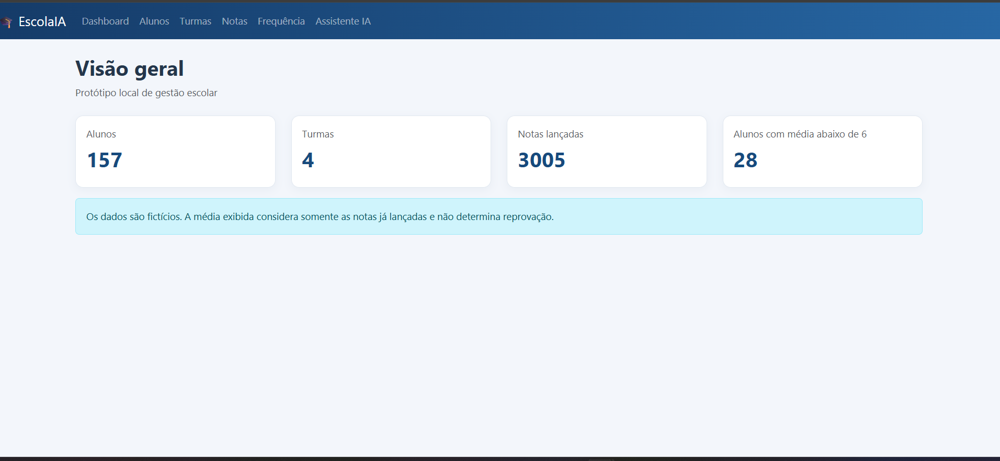
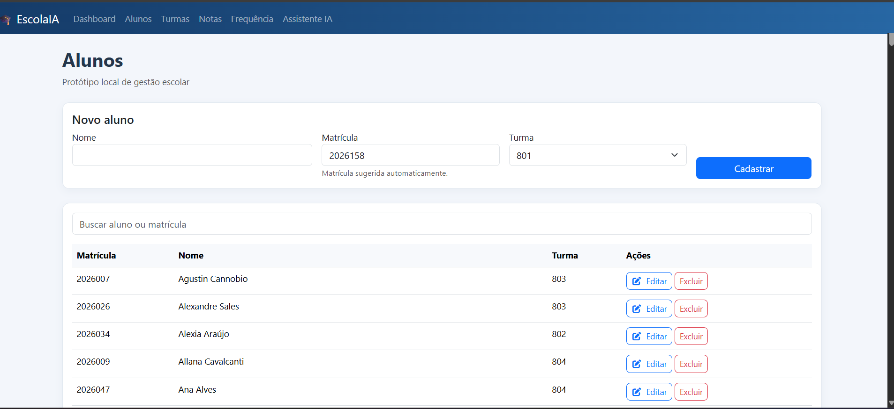
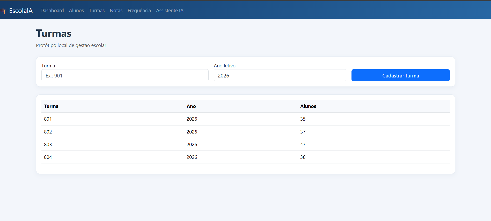
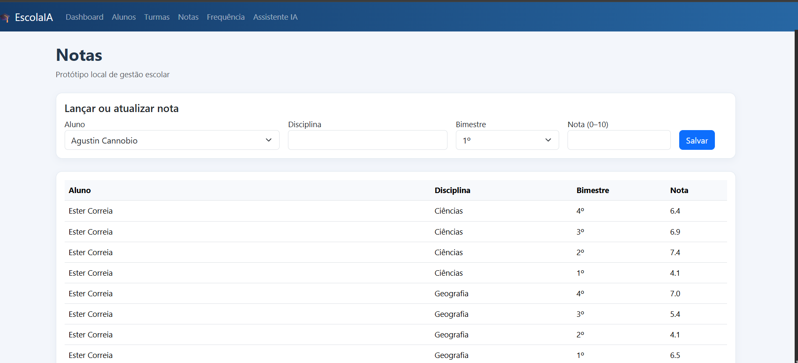
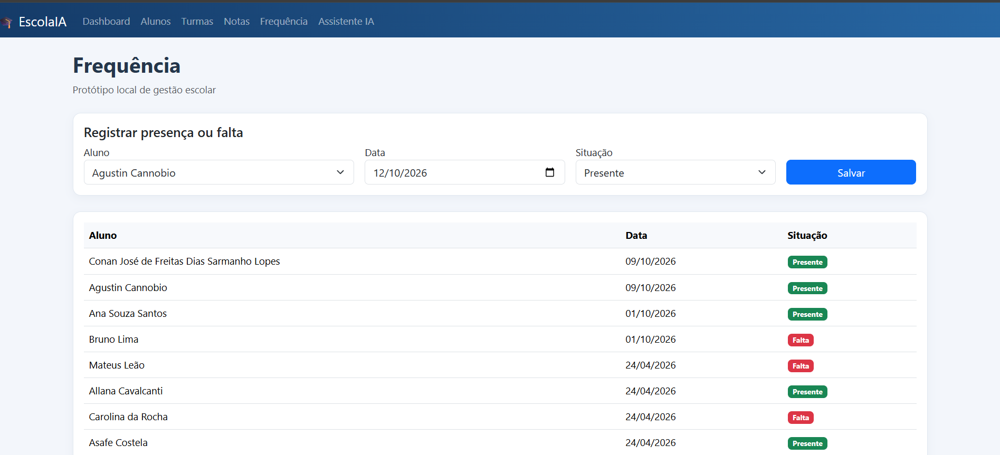
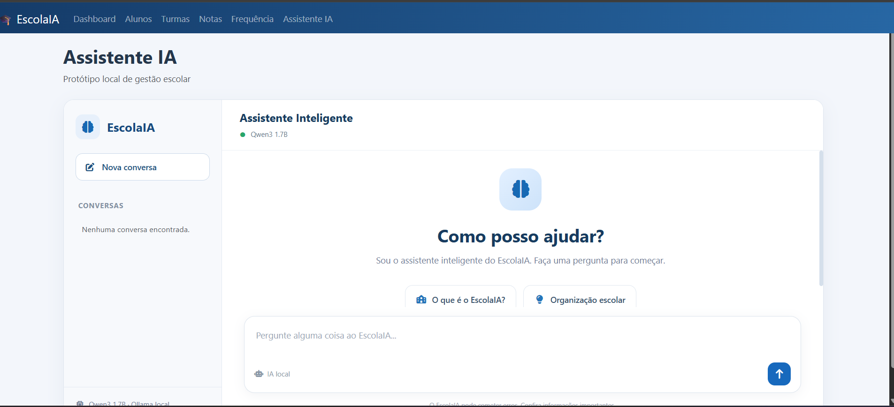

# 🎓 EscolaIA — Gestão Escolar com Inteligência Artificial Local

**Sistema de gestão escolar desenvolvido com Python e Flask, integrado ao modelo de linguagem Qwen3 por meio do Ollama, com consultas em linguagem natural, indicadores educacionais e diagnósticos pedagógicos assistidos por IA.**

O **EscolaIA** é um projeto Full Stack de portfólio que demonstra a integração entre aplicações web, bancos de dados relacionais e modelos de linguagem executados localmente.

Mais do que implementar um chatbot, o projeto explora uma arquitetura em que **consultas e cálculos são realizados pela aplicação**, enquanto a Inteligência Artificial atua como uma camada complementar de interpretação.

## 🚀 Funcionalidades

### 📚 Gestão escolar

- Cadastro, edição e exclusão de alunos.
- Gerenciamento de turmas.
- Registro de notas por disciplina e bimestre.
- Controle de frequência escolar.
- Dashboard com indicadores acadêmicos.

### 🤖 Assistente com IA local

- Integração com **Qwen3 1.7B**, executado pelo Ollama.
- Interface de chat para consultas escolares em linguagem natural.
- Histórico de conversas persistido no SQLite.
- Interpretação contextual de perguntas.
- Identificação de alunos por nome, com tratamento de ambiguidades.
- Restrição das respostas às consultas escolares suportadas pelo sistema.

### 📊 Análises pedagógicas

- Consultas sobre desempenho acadêmico e médias escolares.
- Identificação de alunos com frequência inferior a determinado percentual.
- Comparação de indicadores entre turmas.
- Análise individual de notas e frequência.
- Diagnósticos pedagógicos baseados em dados estruturados.
- Interpretação complementar assistida por IA.

## 🧠 Arquitetura da Inteligência Artificial

O EscolaIA utiliza uma **arquitetura híbrida**, combinando processamento determinístico em Python com interpretação assistida por um modelo de linguagem local.

### Fluxo de processamento

```text
Usuário
   |
   v
Interface de Chat
   |
   v
Flask — API /api/ia/chat
   |
   v
Interpretação da intenção e do contexto
   |
   v
Consultas estruturadas com SQLAlchemy
   |
   v
Banco de Dados SQLite
   |
   v
Cálculos e validações em Python
   |
   +------------------------------+
   |                              |
   v                              v
Resposta estruturada       Diagnóstico individual
                                  |
                                  v
                           Qwen3 via Ollama
                                  |
                                  v
                         Interpretação complementar
   |                              |
   +------------------------------+
                  |
                  v
           Resposta no Chat
                  |
                  v
         Histórico persistido
```

### 🛡️ Confiabilidade das respostas

Um dos desafios técnicos do projeto foi reduzir inconsistências e informações incorretas geradas pelo modelo de linguagem.

Para isso, foram implementadas estratégias como:

- Separação entre cálculos acadêmicos e geração de interpretações textuais.
- Consultas estruturadas ao banco de dados.
- Utilização de informações verificadas como referência factual.
- Tratamento de nomes ambíguos e registros incompletos.
- Restrição do assistente ao domínio escolar suportado.
- Preservação dos relatórios calculados pelo Python quando a IA está indisponível.

**A IA não é responsável por inventar indicadores ou calcular resultados acadêmicos. Os dados e as regras de negócio permanecem sob controle da aplicação.**

> **Nota técnica:** o projeto utiliza uma LLM pré-treinada integrada localmente. Não envolve treinamento de um modelo próprio, banco vetorial, RAG baseado em embeddings ou implementação do protocolo MCP.

## 💻 Tecnologias

| Tecnologia | Utilização |
|---|---|
| Python | Regras de negócio, consultas e processamento de dados |
| Flask | Aplicação web e API |
| SQLAlchemy | ORM e acesso ao banco de dados |
| SQLite | Persistência de dados e histórico de conversas |
| Qwen3 1.7B | Interpretação pedagógica assistida por IA |
| Ollama | Execução local do modelo de linguagem |
| HTML, CSS e JavaScript | Interface web |
| Faker | Geração de dados sintéticos |
| Requests | Comunicação HTTP com o Ollama |

## 💬 Exemplos de consultas

O assistente foi desenvolvido para interpretar consultas como:

```text
Quantos alunos estão cadastrados?

Qual turma possui a maior média em Matemática?

Quais alunos possuem média inferior a 6?

Quais alunos têm frequência abaixo de 75%?

Faça uma análise pedagógica de Conan.
```

As respostas dependem das consultas reconhecidas e dos dados disponíveis no sistema.

Perguntas fora do domínio suportado recebem uma mensagem explicativa, sem serem encaminhadas ao modelo de linguagem.

## 📁 Estrutura do projeto

```text
escola_ia/
├── services/
│   ├── __init__.py
│   └── ollama_service.py
├── static/
├── templates/
├── app.py
├── config.py
├── functions.py
├── models.py
├── popular_banco.py
├── requirements.txt
├── .gitignore
└── README.md
```

**Arquivos locais não versionados:**

- `.env` — configurações e chave secreta.
- `escola.db` — banco de dados SQLite.
- `env/` — ambiente virtual Python.

## ⚙️ Instalação

### Pré-requisitos

- Python 3.10 ou superior.
- Git.
- Ollama instalado.

### 1. Clonar o repositório

```bash
git clone https://github.com/sarmanhodev/escola_ia.git
cd escola_ia
```

### 2. Criar e ativar o ambiente virtual

```bash
python -m venv env
```

**Windows:**

```powershell
.\env\Scripts\activate
```

**Linux/macOS:**

```bash
source env/bin/activate
```

### 3. Instalar as dependências

```bash
pip install -r requirements.txt
```

### 4. Configurar a aplicação

Crie um arquivo `.env` na raiz do projeto:

```dotenv
SECRET_KEY=substitua_por_uma_chave_aleatoria_segura
```

Para gerar uma chave:

```bash
python -c "import secrets; print(secrets.token_hex(32))"
```

O arquivo `.env` não deve ser enviado ao GitHub.

### 5. Instalar o modelo de IA

Com o Ollama instalado, execute:

```bash
ollama pull qwen3:1.7b
```

Certifique-se de que o serviço do Ollama esteja em execução.

### 6. Inicializar o banco de dados

```bash
flask --app app init-db
```

Esse comando pressupõe a versão do `app.py` que registra o comando `init-db`.

### 7. Gerar dados de demonstração

```bash
python popular_banco.py
```

O script gera dados sintéticos de alunos, notas e frequência.

**Atenção:** na implementação atual, executar esse script novamente pode adicionar novos alunos. Utilize-o preferencialmente em um banco recém-criado.

### 8. Iniciar a aplicação

```bash
python app.py
```

Acesse:

**http://127.0.0.1:5000**

## 🗃️ Dados sintéticos

O projeto utiliza o Faker para gerar registros fictícios de estudantes.

Os dados demonstrativos incluem:

- Alunos distribuídos entre turmas.
- Notas de diferentes disciplinas e bimestres.
- Registros de presença e ausência.
- Perfis simulados de desempenho acadêmico.

O objetivo é permitir a demonstração e o estudo da aplicação sem depender de dados reais de estudantes.

## 🎯 Desafios técnicos

Durante o desenvolvimento do EscolaIA, foram explorados problemas comuns na integração entre aplicações tradicionais e Inteligência Artificial generativa:

**1. Consultas em linguagem natural**

Converter perguntas em operações estruturadas sobre um banco relacional.

**2. Contexto conversacional**

Utilizar o histórico de mensagens para interpretar perguntas de continuidade.

**3. Ambiguidade de entidades**

Identificar corretamente alunos e evitar respostas baseadas em correspondências incertas.

**4. Confiabilidade dos indicadores**

Garantir que médias, percentuais e frequências sejam calculados pela aplicação.

**5. Controle de alucinações**

Limitar a interpretação da IA a informações previamente verificadas.

**6. Execução local**

Integrar um modelo de linguagem sem depender de uma API externa para a inferência.

## 📌 Escopo

O EscolaIA é um **projeto demonstrativo de portfólio**, desenvolvido para explorar conceitos de engenharia de software, desenvolvimento Full Stack e integração de Inteligência Artificial.

Não se destina ao uso institucional com dados reais de estudantes sem adaptações adicionais de segurança, autenticação, autorização e proteção de dados.

## 🖥️ Demonstração do Sistema

### 📊 Visão geral
Indicadores de alunos, turmas, notas lançadas e médias abaixo do valor de referência.



### 👨‍🎓 Gestão de alunos
Cadastro, pesquisa e gerenciamento de alunos.



### 🏫 Turmas
Cadastro e distribuição de alunos por turma.



### 📝 Notas
Lançamento e atualização de notas por disciplina e bimestre.



### 📅 Frequência
Registro de presenças e faltas.



### 🤖 Assistente IA
Interface de chat com integração local ao Qwen3 via Ollama.




## 👨‍💻 Desenvolvedor

**Diego Sarmanho**

Desenvolvedor Full Stack com experiência em Python, PHP, APIs REST, automação, análise de dados e Inteligência Artificial aplicada a sistemas.

🌐 **Portfólio:** https://portifolio-sarmanho.onrender.com/home

💻 **GitHub:** https://github.com/sarmanhodev

---

**EscolaIA — Inteligência Artificial aplicada a dados escolares com contexto, controle e confiabilidade.**
